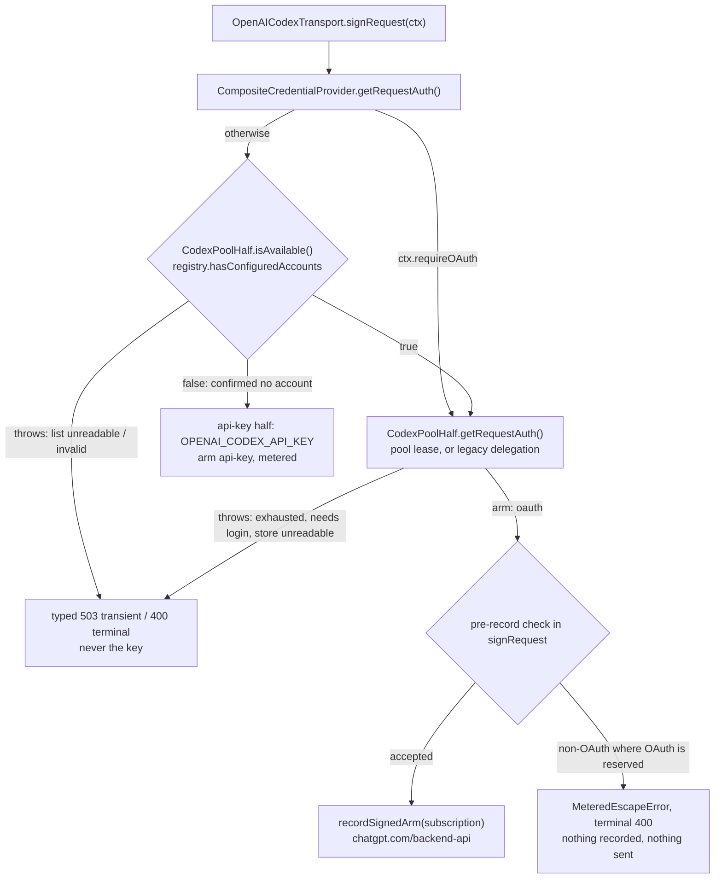

> Several subscriptions per claudish provider, switched automatically when one runs out: why the
> account list is read fail-closed, why availability is a configuration fact, why a failed
> subscription never falls through to a metered key, and why the refresh gate never runs unlocked.
>
> Indexed in [`README.md`](./README.md). Scenario matrix with mutations:
> [`accounts-validation.md`](./accounts-validation.md). Review history and evidence:
> [`../reports/multi-subscription-plan-review-2026-09.md`](../reports/multi-subscription-plan-review-2026-09.md).
> Siblings: [`keychain.md`](./keychain.md), [`onepassword.md`](./onepassword.md).

# Multi-subscription accounts

**Status:** Phases 0, 1 and **2a** are built, and Phase 2a **shipped in v14.5.0** (2026-10-25,
merge commit `8567bab8`, PR #351). The Codex pool is **on the request path**:
`makeCodexCredential()` installs `CodexPoolHalf`, HTTP quota rotation runs in `ComposedHandler`, and
the mutating `claudish account … codex` verbs exist. Phase 2a is verified two ways. Targeted tests
drive the production factory, transport and handler in an isolated child against loopback OAuth,
token and metered listeners. A real two-account run on 2026-10-22 used the owner's legacy login
`default` and a second owned login `second`: after one `cx@` turn `default` read `7d 41%`; with
`switchAt` lowered to 30% the next turn selected `second` (`5h 0% · 7d 0%  active`). Rotation on a
real quota 429 was not exercised: claudish never exhausts an account on purpose. D8 (a real
in-stream `usage_limit_reached` capture) now gates Phase 2b, not a merge. Phase 2b, Phase V, the
Claude pool, the `account use` handoff and polish are planned. **Last updated:** 2026-10-26. Claude
Code facts: measured against Claude Code **2.1.268**.

**Errors go through main's classifier.** Every failed sign, refresh, forced re-sign and
response-side accounts query is answered by `ComposedHandler.answerAuthFailure`
(`handlers/shared/auth-failure.ts`). A terminal Codex failure is 400 with
`x-claudish-auth-verdict: terminal`: an explicit `cx@` stops there, and a bare-name routing chain
moves to its next hop, metered included, with one stderr notice naming that hop's billing (owner
decision 2026-10-21, `9ace3fe5`; `routing.md`). A transient one is 503 (or the token host's real
429/5xx) with `x-claudish-auth-verdict: transient`, retried on the same hop and never advanced.
True pool exhaustion takes the verdict-free quota seam, which advances a bare chain with the
`billed PER TOKEN` warning. The table is in *The error surface, as
built*; anything below that says a chain "advances on 401" or names `mapAccountsError` describes
the pre-v13 design and is superseded.

A Claude Pro/Max or ChatGPT/Codex subscription runs out of its 5-hour or weekly window in the middle
of a working day, and users who pay for several want claudish to change account on its own. Before
this feature claudish held one credential per OAuth provider (`CodexOAuth` is a singleton over one
file). On the native Claude path it held none: `NativeHandler` forwarded Claude Code's own
`authorization` header and dropped every `anthropic-ratelimit-unified-*` header.

The finished feature keeps one **sticky** account per claudish provider, because the prompt cache
belongs to one account. It switches **before** a request when any window passes a threshold
(default 0.90). On a quota rejection it marks the account exhausted until its reset and retries the
identical request **once** on the next account. When nothing is left, the error names every account
and its reset.

One rule carries the design; most of this document is the failure modes that forced it:

> Whether the metered arm is in play is decided ONCE, ahead of the credential chain, by a predicate
> over CONFIGURATION — never by an exception inside the chain, never by a catch above it, and never
> by an I/O result.

The cost is deliberate. A pooled user can no longer degrade silently to a working metered request,
so a claudish bug or an unreadable store becomes a visible failed request instead of an invisible
charge.

## Requirement ids

Decisions, rows and code comments cite these.

| Id | Requirement |
|---|---|
| F1 | Several accounts per claudish provider; version 1 is `native-anthropic` and `openai-codex` |
| F2 | One active, sticky account per claudish provider |
| F3 | Switch before a request past a threshold (default 0.90, overall and per window) |
| F4 | On a quota rejection, mark exhausted until reset and retry the identical request once. Anthropic: 429 with `anthropic-ratelimit-unified-status: rejected`. Codex: a 429/403 quota body, or in-stream `usage_limit_reached` before any content |
| F5 | When every account is spent, name each account and its reset, or say it needs a login |
| F6 | Usage comes from ordinary response headers; idle accounts are polled only in long-lived processes |
| F7 | `claudish account add\|import\|login\|list\|status\|remove\|enable\|disable\|use` |
| F8 | `account use <label>` (Claude only) also writes Claude Code's own Keychain item |
| F9 | The TUI Providers tab shows each account's usage, state and reset |
| F10 | Single-account users migrate with no action: `~/.claudish/codex-oauth.json` becomes account `default` |
| N1 | Every pooled OAuth artifact carries `arm: "oauth"`; exhaustion never falls through to `OPENAI_CODEX_API_KEY` |
| N2 | Concurrent processes share state on disk, written atomically under a lock |
| N3 | Exactly one process refreshes a given account; rotation must not lock the user out |
| N4 | No secret in config, output, exports or env vars |
| N5 | No test touches the real login Keychain; no `mock.module()` |
| N6 | Nothing changes for a user with one account |
| C1–C4 | Constraints: the terms-of-service gray area; `account import claude` ships beside claudish's own PKCE login (C2); Claude Code's facts are re-checked, never pinned silently; the unverified facts that became gates D1–D8 |

## Built and planned

```
V (spike) ──────────────┬──────────────────────────► 3 ──► 4*
                        │                            ▲
0(a..i) ────────────────┴──► 1 ──► 2 ──────────────► 5
D8 gates Phase 2b · D1/D2 gate import, `account use` and the login rule
4* ships only on the D1/D2 branches that permit it
```

| Phase | Content | Status |
|---|---|---|
| **V** | Resolve D1–D8 against a scratch `CLAUDE_CONFIG_DIR`, into `ai-docs/reports/claude-oauth-facts-<date>.md` | **Not run** |
| **0** | Nine existing defects, below | **Built**, on the request path |
| **1** | `auth/accounts/*`; `subscriptionAccounts` in the config type, `loadConfig`'s allowlist and the Zod schema; read-only `claudish account list\|status [--json] [--refresh]` | **Built**, off the request path |
| **2a** | `CodexPoolHalf`; the three availability projections; routing retention of a failed Codex candidate; HTTP 429/403 quota rotation at the Codex status swap; the capacity-remaining 429; the narrow quota seam in `error-surface.ts`; outcomes and `CLAUDISH_ACCOUNTS_LOG`; false-mode stream marking; the mutating `account … codex` verbs; legacy enrollment and durable suppression; the shared config lock | **Shipped** in v14.5.0, on the request path; loopback-verified by targeted tests and a real two-account run (2026-10-22) |
| **2b** | D8 capture; extended stream watch and in-stream rotation; T-C7, T-M3, T-L1 against the capture | Planned; gated on D8 |
| **3** | `auth/claude-oauth.ts`, PKCE login, `NativeHandler` rotation, launch modes, `account add claude`, `import` where D1/D2 permit | Planned; blocked on ratifying decision 9 and C6 |
| **4** | `claude-code-credentials.ts`, the journalled `account use`, the dual-store refresh | Planned, conditional on D1/D2; T-C5 first |
| **5** | Idle polling, statusline labels, the TUI Accounts block, a `docs/` page, the live run | Planned |

Phase 0, each item independent of the feature:

| | Defect | Fix |
|---|---|---|
| (a) | the Codex token file was written truncate-first; a crash left a zero-byte file and a logged-out user | `atomic-write.ts`: temp, `fsync`, explicit `chmod 0600` (the umask masks `openSync`'s mode), rename, directory `fsync` |
| (b) | no cross-process lock | `file-lock.ts`, `refresh-lock.ts`, `state-lock.ts` |
| (c) | a Codex 401 dead-ended at 400 | re-sign through main's `forceRefreshAuth(ctx)`, which `OpenAICodexTransport` implements as a forced `signRequest` carrying `pin`, `rejected` and `requireOAuth` (the one re-sign path since the v14 rebase), rebuilding endpoint and headers from the returned binding; main's `isSameCredentialSilo` backstop refuses to resend under another account — only on `arm: "oauth"`, since re-signing a bad api key would trade the inline 400 for a retryable 401 (#148) |
| (d) | the artifact lived on the shared transport, so concurrent turns could sign with each other's credentials | `signRequest()` returns it; `handle()` holds it as a local `AuthBinding` (main's shape), passed to `transformPayload`, `getEndpoint` and `getHeaders` |
| (e) | in-stream `usage_limit_reached` froze into the transcript as `[API Error: …]` | a `quota` sniffer verdict, surfaced as 400 with `upstream_status: 429` |
| (f) | `NativeHandler` dropped the plan-window headers | `anthropic-ratelimit-*`, `retry-after` and request ids pass through on both branches; the body is serialized once |
| (g) | `count_tokens` republished a 401 as a 200 | signs like `/v1/messages`, keeps the status |
| (h) | the hardcoded Keychain service missed the `CLAUDE_CONFIG_DIR` hash suffix | `claudeCodeKeychainService(env)` |
| (i) | no way to point the real binary at a fake upstream | the loopback-only `CLAUDISH_TEST_UPSTREAM` and the `CLAUDISH_ACCOUNTS_FAULT` vocabulary |

**On the request path:** everything in Phase 0 and Phase 2a. The Codex credential's primary half is
`CodexPoolHalf`, whose `isAvailable()` is the registry's presence fact, not
`CodexOAuth.hasCredentials()`. Every `CodexOAuth` refresh still runs through
`withRefreshGate("openai-codex", "legacy-codex", …)` (fix A1), the same lock file the pool uses for
the synthesized legacy account and for an enrolled `legacy-codex-file` row, whatever that row's
generated id.

**The migration population (F10, N6).** When the registry reports the synthesized legacy account,
no configured rows and no suppression marker, `CodexPoolHalf` delegates signing verbatim to the old
`CodexOAuthHalf` and returns its artifact **without `account`**, so rotation and outcomes never
activate for a single-login user. `requireOAuth` and `forceRefresh` are forwarded unchanged. The
registry is consulted **first**, so what decides the request is the registry's view of
`codex-oauth.json`:

| `~/.claudish/codex-oauth.json`, no Codex rows | Registry | The request |
|---|---|---|
| no file: `stat` fails `ENOENT`/`ENOTDIR` | absent | api-key half, as before |
| readable, but names no refresh token | absent ("present-and-empty") | api-key half |
| `EACCES` on the file or its parent, `EIO`, `EMFILE`; or truncated, empty or invalid JSON | failed; with no last-known-good, throws `AccountListUnavailableError` | **503**, `upstream_status: 503`, verdict `transient`, naming the source. Never the key |
| a readable login | present | delegated to `CodexOAuth`, `arm: "oauth"`, byte-identical to the pre-2a build |

The third row is the **N6 exception** owner question 3 accepted: before 2a the singleton answered a
terminal 400 naming `claudish login codex`; the registry now answers a transient 503, because it
cannot tell an `EMFILE` from damage. `config.json` follows the same rule with one split: an I/O
failure is the transient 503, but malformed JSON or an invalid `subscriptionAccounts` block is
`AccountListInvalidError`, a terminal 400 naming the file and field. That applies to **every**
`cx@` user, legacy-only and API-key-only included, because the registry reads `config.json` before
deciding anything. With a last-known-good list, the request is served from it and the failure is
exposed as a diagnostic. An I/O failure is never cached and a parse failure is cached only against
the file's stamp, so the next readable request after a repair recovers with no restart.

## Where things live

```
~/.claudish/config.json                                   subscriptionAccounts — the account list, no secrets
~/.claudish/codex-oauth.json                              the LEGACY Codex account, left in place
~/.claudish/accounts/state.json                   (0600)  usage, exhaustedUntil, needsReauth, owner, active
~/.claudish/accounts/state.lock                           guards state.json's read-modify-write
~/.claudish/accounts/locks/<provider>/<id>.lock           the refresh gate, one per account
~/.claudish/accounts/tokens/<provider>/<id>.json  (0600)  the file token store (directory 0700)
Keychain service "claudish-accounts", account "<provider>:<id>"   one JSON blob per account
```

```jsonc
"subscriptionAccounts": {
  "openai-codex": {
    "generation": 3,
    "switchAt": 0.9,
    "switchAtByWindow": { "primary": 0.8 },
    "noticeAcceptedAt": "2026-10-22T09:00:00Z",
    "legacyCodexSuppressed": true,          // set by removing the legacy login; see below
    "accounts": [
      { "id": "a1b2c3d4e5f6", "label": "work", "store": "keychain",
        "addedAt": "2026-09-01T10:00:00Z", "identity": { "plan": "pro" } }
    ]
  }
}
```

`subscriptionAccounts` is owned by the file on disk, never by an in-memory config object: see
*Config ownership* below.

`id` is generated and opaque (`^[a-z0-9]{12}$`) because it is interpolated into two paths; both
`registry.ts` and `paths.ts` refuse any other. `label` is the user-facing handle and the only thing a
command line names. The provider is in the **path**, not the filename, because two claudish
providers can mint the same id (V15). The synthesized legacy account's id is `legacy-codex` —
outside the pattern, so no configured account can collide with it — and its label is `default`.

**`owner` lives in `state.json` alone.** Two documents holding the named refresher, with no rule for
which wins, is how two processes come to choose different refresh protocols.

## Who pays: the single decision point



### One configuration fact, three consumer contracts

```ts
registry.hasConfiguredAccounts("openai-codex")   // the presence fact
  == ≥1 Codex row in config.subscriptionAccounts["openai-codex"].accounts, ENABLED OR NOT
     OR (no rows, not suppressed, and a readable legacy ~/.claudish/codex-oauth.json)
```

No Keychain call, no token file, no `await`: it stats the two account-list documents and re-reads
one only when its stamp changed. One computation feeds three consumers, which answer an unknown
list differently on purpose:

| Consumer | Configured / absent | Cold unreadable or invalid, no last-known-good |
|---|---|---|
| **Sign-time availability:** `CodexPoolHalf.isAvailable()`, `AccountPool.hasAnyCredentials()` | true / false | **throws** `AccountListUnavailableError` (I/O) or `AccountListInvalidError` (malformed `config.json`) |
| **Transport safety:** `OpenAICodexTransport.poolConfigured()` | true / false | **true**, never throws: an unknown list reserves the subscription side |
| **Unsigned billing:** the registered Codex probe in `billing-probe.ts` | SUB / metered | **SUB**, never throws: a conservative label, not evidence that signing can succeed |

The last two are `registry.mayHaveConfiguredAccounts()`, which catches and answers true. The probe
still reads the signed-arm record **first** (what did sign beats what would), and an unexpected
throw from a registered Codex callback is contained as SUB both in `installBillingProbes` and in
the auth-free pricing leaf (`remote-provider-types.ts`). A genuinely unregistered probe keeps the
old metered default. The singleton disjunct is gone (M4): `CodexOAuth.hasCredentials()` is no
longer anyone's billing oracle.

**A disabled row still reserves OAuth** (owner question 2). `enabled` is a selection predicate, not
presence: disabling the last row, or the whole pool, gives `NoUsableAccountError` and never signs the
key. Only `account remove` makes the key effective, and it says so. **Suppression with zero rows is
confirmed absence**: after the legacy login is removed, a NEW request may sign the key.

Two escapes shaped presence, both found in plan review:

1. **The transport catch.** `refreshAuth()` was `try { … } catch { this.cachedAuth = null }`, and a
   null artifact meant `api.openai.com`, `Bearer $OPENAI_CODEX_API_KEY` and a `metered` record.
   Phase 0 replaced it with `signRequest()`, which has **no** `try/catch`, and review fix F11
   deleted the Codex `refreshAuth()` bridge and `legacyAuth` outright.
2. **The availability contract.** `CredentialProvider.isAvailable` is documented "never throws — a
   1Password auth failure resolves to false". Revision 1 computed the predicate from stored token
   material, so a locked Keychain, a denied ACL or an `EIO` became `false`, and the composite took
   the api-key half.

So availability answers a **configuration** question. Exhaustion, `needsReauth` and an unreadable
token store are **readiness** facts and never lower it; `false` means only "no OAuth configured".

`CodexPoolHalf.isAvailable()` **may throw** — a deliberate departure from the never-throws contract,
which exists so a 1Password prompt failure cannot take the server down and predates any provider
using availability to pick between a free and a paid credential. Where the answer decides who pays,
"unknown" must resolve to the safe side, and the only way to say it through a `Promise<boolean>` is
to throw. The throw is safe: `makeCodexCredential()` passes no `fallbackSignal`, so the composite
rethrows, and `CredentialAuthority.getRequestAuth` does not catch. `CodexPoolHalf` is the only
provider permitted this.

### The request's OAuth latch and the nets

Configuration can change mid-request: a row removed by `account remove`, a `claudish logout codex`,
a config file going unreadable. So the handler keeps one request-scoped `state.requireOAuth`, set
once any accepted artifact has `arm: "oauth"` and never cleared, and every later sign (rotation,
401 forced re-sign, a Responses retry leg's re-sign, which is also pinned to the turn's account)
forwards it. Four independent checks enforce it:

- **Composite dispatch.** For `openai-codex` with `requireOAuth`, the composite calls the primary
  **before** asking availability, so a removed pool cannot select the key half. It rejects an
  artifact that is not `oauth`, or names an account of another claudish provider (F12).
- **The pool half.** With no pin and no configured rows under `requireOAuth`, it throws
  `MeteredEscapeError` ("the account list disappeared during this request"); a pin is always
  validated by acquisition, so a removed pinned account is an account error, not a fallback.
- **The transport, before the arm is recorded.** `signRequest` throws `MeteredEscapeError` when
  `requireOAuth || poolConfigured() || signed.account` holds and the artifact is not a Codex OAuth
  artifact. Nothing is recorded, so a rejected artifact can never poison the billing record.
  `recordSignedArm` is written here and nowhere else, from the accepted `auth.arm`.
- **The handler, before fetch.** `attempt()` repeats the check with `state.requireOAuth ||
  poolConfigured()`, independent of the transport. A post-record backstop that does fire returns
  its terminal 400 verbatim: the metered record makes the probe answer metered, so
  `FallbackHandler` does not continue.

Parameter, network and overload re-issues reuse the already-accepted artifact; they never re-sign.

### Routing keeps a failed Codex candidate

`applyCandidateFilters` drops every `failed` readiness verdict, which for Codex would route a bare
`gpt-*` straight to a metered hop when the account list is merely unreadable. The authority now
attaches `failureReason: "accounts-list"` to a readiness failure caused by
`AccountListUnavailableError` or `AccountListInvalidError` only, and `routing-rules.ts`
(`isCodexAccountsFailure`) keeps that candidate at its original position, with its diagnostic,
neither skipped nor reported as no-credential. Its availability stays unknown, with no discovery
call, so cached not-served evidence cannot remove it either. The handler then answers the typed
503 or 400. Other providers' failed credentials are filtered as before; no text is parsed.

The proxy used to sign every API-key-named transport at construction. For Codex that leased once
at startup and, with a cold failed list, threw outside the classifier as a proxy 500. Codex now asks
non-leasing readiness at construction: confirmed absence keeps the no-credential refusal, a failed
list reaches the handler, and signing happens per request.

## The account list is read fail-closed

When the design was written, both of the repo's existing accessors answered a read **failure** with
**absence**. `loadConfig()` still does: it returns `{...DEFAULT_CONFIG}` on any read or parse error,
leaving `subscriptionAccounts` undefined. `CodexOAuth.loadCredentials()` returned `null`, which
`hasCredentials()` read as "no credentials". Either made the predicate false and billed a flat-rate
user per token. Round 3 found this unanimously, after revision 2 had called the predicate one that
"cannot fail" — true of the predicate, false of its two inputs. The V16b fix made `CodexOAuth`
record the failure instead, but its answer was still not the registry's (no last-known-good list,
no throw). Since 2a the registry is consulted before the facade, so the registry's answer is the
one a request gets (the migration table above).

`registry.ts` therefore calls neither. It parses both documents itself:

| Outcome | Decided by | Answer |
|---|---|---|
| **present** | read, parsed and valid | the account list as written |
| **absent** | `stat` gives `ENOENT` or `ENOTDIR`, and nothing else | a legitimately empty list |
| **failed** | any other `stat` error; any read, parse or validation error | the last known-good list; with none, **throw**: `AccountListUnavailableError` (transient 503) for an I/O failure of either source and for a malformed legacy file; `AccountListInvalidError` (terminal 400) for malformed JSON or an invalid account block in `config.json` |

```
Could not read the <path> account list: <detail>. Refusing to treat an unreadable account list as an empty one.
Invalid account list in <path>: <field>: <problem>. Repair the named config field.
```

The failure carries its source, actual path and type (`io` or `invalid`) as structured fields, never
inferred from message words. A JSON syntax diagnostic says `invalid JSON` instead of echoing source
bytes, which may hold a secret. Malformed `config.json` is terminal because repeating a 503 forever
would hide a file only the user can repair; a malformed legacy file stays transient, the disclosed
N6 exception.

- **`existsSync` is not an absence test.** It answers `false` for a permission-denied parent, which
  read an unreadable directory as "no accounts" (B1). The token stores follow the same rule, and so
  does `CodexOAuth`'s own read of the legacy file since the V16b fix.
- **The stamp is recorded only after the bytes were read.** A transient `EACCES` or `EMFILE` is
  retried on the next answer instead of cached until the file changes. A parse or validation failure
  *is* cached against `{mtimeMs, size, ino}`, being a pure function of the bytes.
- **Validation rejects; it never drops or accepts.** After `SubscriptionAccountsSchema`: the id
  pattern, unique ids, at most one Codex row on the legacy store (one refresh token, two gates) and
  none on Claude, and only `switchAtByWindow` keys the usage layer can produce. A bad entry fails
  the whole read and names the field. Dropping it silently changes who pays; accepting it silently
  never applies.
- **`snapshot(scope)` narrows which failure is fatal.** An unreadable legacy file fails Codex
  answers closed and leaves Claude answers alone. `config.json` carries both, so its failure is
  always fatal.
- **The legacy account is synthesized in memory, only when no Codex account is configured and
  `legacyCodexSuppressed` is not set**, and is never written into `config.json` by a read. That
  covers the whole F10 migration base with zero user action. Once rows exist, or the marker is set,
  the legacy file is ignored entirely: even an unreadable leftover cannot fail an independent pool.
- **`subscriptionAccounts` is in `loadConfig`'s allowlist.** Without it the account list survives
  until the first global save and is then dropped, and every request signs metered.

## No metered fall-through when a subscription fails

**Decision 10**, built for both populations. On the legacy path, fix A4 makes every `CodexOAuth`
refresh failure throw `CodexOAuthRefreshError` (`terminal`, `upstreamStatus: 401`, one line naming
`claudish login codex`), surfaced as an inline 400. On the pool, every failure is a typed accounts
error from the table below, and none of them, nor any catch above them, returns an api-key
artifact.

User-visible consequence: someone whose ChatGPT login has expired **and** who has
`OPENAI_CODEX_API_KEY` set used to be served silently on that metered key; they now get the error.
A user with no OAuth login at all (no rows, and no file or one naming no refresh token) still signs
with the key: the composite's api-key half returns an artifact rather than throwing.

Within `openai-codex` there is no fall-through and no config flag to enable one: the request's own
api-key half never signs after its OAuth arm failed. A **bare** `gpt-*` name is a routing chain of
OTHER hops, and what happens there depends on the answer's verdict:

- **Terminal credential failure** (`NeedsReauthError`, `NoUsableAccountError`,
  `AccountListInvalidError`, a pre-record `MeteredEscapeError`): main's rule since `9ace3fe5`
  (owner, 2026-10-21). The chain moves to its next hop, whatever that hop bills, and
  `announceCredentialRejection` prints one stderr line per provider and status naming the next hop
  and its billing, with the login hint. `FallbackHandler` asks `isSubscriptionProvider("openai-codex")`,
  which the registered probe answers SUB for a configured pool, so these errors count as a
  subscription's rejection. If no hop serves, the chain answers `all_providers_failed` with the
  first rejection's message; a rejection that was the only failure returns its own 400. The rule it
  replaced (v13) continued only to subscription candidates.
- **Transient failure**: returned verbatim and retried on the same hop, even behind an earlier
  failed candidate, with no cost warning.
- **True pool exhaustion** (`AllAccountsExhaustedError`): decision 1, the only answer that may advance
  onto a metered hop, with the `billed PER TOKEN` warning. An explicit `cx@` stops with the message.

## The refresh gate never runs unlocked

A refresh that proceeds unlocked is two exchanges against a server that rotates refresh tokens: the
second presenter gets `invalid_grant` and the account is logged out. The 1Password handshake lock
wants the opposite — "an OPTIMISATION OF WHEN, not a gate on WHETHER" — and runs its work unlocked on
timeout or any filesystem error. Round 1 found, unanimously, that the first design had extracted
exactly that lock for token refresh.

`file-lock.ts` therefore makes the failure semantics the **caller's** choice,
`withFileLock(path, {onUnavailable: "fail" | "proceed"}, work)`, with **no default**: choosing it
silently is the mistake copying the nearest precedent produces. `refresh-lock.ts` has no proceed
mode at all.

| Property | Refresh gate | `state.lock` |
|---|---|---|
| Path | `accounts/locks/<provider>/<id>.lock` | `accounts/state.lock` |
| Create | `openSync(path, "wx")`, mode 0600 | same |
| Acquire timeout | **20 s**, polled at 50 ms + jitter | **2 s**, polled at 25 ms + jitter |
| Heartbeat | every **10 s**, for the **whole** hold | none; the hold is milliseconds |
| Stale TTL | **60 s**, six missed heartbeats | **10 s** |
| Dead holder | same host and `kill(pid, 0)` fails: stolen at once | same |
| Foreign host | never stolen, never waited out: `foreign-host` | same |
| On failure | `RefreshUnavailableError`, never unlocked | the caller drops the update, silently or loudly |

They fail differently on purpose. Failing a turn because an **exhaustion mark** could not be written
is worse than the mark arriving late; failing a **refresh** because the gate was held is better than
two refreshes.

When the gate cannot be taken, the waiter re-reads the store **uncached**. If the `generation`
advanced and the token is fresh, the holder persisted while it waited, and that is success.
Otherwise it raises `RefreshUnavailableError`: transient, with no quota wording, so it can never
pass for exhaustion. Beyond that:

- **An unwritable lock directory disables refresh** ("refresh disabled"). There is no bypass env
  var; `CLAUDISH_NO_OP_HANDSHAKE_LOCK` belongs to 1Password.
- **Shared HOME across hosts is unsupported.** A remote holder's liveness is unobservable, so any TTL
  is a guess, and claiming exactly-once refresh across hosts would not be true.
- **`state.lock` is always innermost** and never held across a gate acquisition, so there is no
  deadlock to bound.
- **No lock is held across a browser.** `CodexOAuth.login()` takes no gate: it presents an
  authorization code, not the refresh token, and a completed browser login must never be discarded
  because a lock was busy (its config-lock check after the browser waits up to 15 s rather than
  failing). `claudish account login codex <label>` runs PKCE with no lock, then holds the account's
  gate only for the final uncached, generation-aware token write and target revalidation.
- **The refresh side re-reads before it persists**, on both paths. `TokenManager` re-reads
  uncached after the exchange: newer material (generation or fingerprint moved) wins and is not
  overwritten; a store that vanished is never recreated (`NeedsReauthError`). Its account check is
  phased: **before the exchange** it refuses a removed, rebound or disabled row and propagates a
  typed list error; **after the exchange** it refuses only a confirmed removal or rebinding and
  ignores a list read failure, because the vendor has already rotated and refusing would discard the
  new grant and strand the journal.

The 1Password lock is untouched (decision 6). It keeps its own ~60 lines of `O_EXCL` code because it
also carries `lastHandshake`, `isAbandoned`, `peerHoldsHandshakeLock` and its bypass variable, none
of which belong to a renewable lease.

## Identity over properties

Several review findings had one shape: a check compared a **property** two different things can
share, where it needed an **identity** only one thing has.

| Where | The property that lied | The identity compared now |
|---|---|---|
| Lock release and fence | `pid`: two hosts sharing a HOME can hold the same pid, and a paused holder can resume after a steal | a 16-byte **nonce** per acquisition; release and `holdsLock()` compare `{host, pid, nonce}` |
| Forced refresh after a 401 (B6) | `expiresAt`: a revoked bearer looks fresh, so the gate holder handed the dead token back | `sha256(rejectedAccessToken)[0:16]`: under the gate the stored token is exchanged **if it is still that one**, whatever its expiry |
| Ambiguous write (B7) | `generation` and fingerprint: a journal write changes neither, so every ambiguous journal write resolved as committed | a random **`writeId`** minted per persist; committed iff it is on disk after an uncached re-read |
| Lock steal (B4) | "the holder I read": two waiters judge the same stale holder, both `rm`, and the second deletes the first's new lock | **rename** to a unique tombstone, then compare nonce, pid, host **and** `at`; a mismatch is restored with `link()`, which refuses to overwrite a third party. Release does the same |
| Heartbeat (B5) | the **path**: `holdsLock()` then `openSync(path, "r+")` could rewrite a successor's file | one positional write through the **descriptor** the acquire opened, padded to 256 bytes, no truncate; a late heartbeat lands on the orphaned inode |
| In-process refresh slot (A1) | "a flight is running": an unconditional `finally` nulled a newer flight | cleared only if it still holds that same promise |
| Absence (B1) | `existsSync() === false` | `stat` returning `ENOENT`/`ENOTDIR` |

B5 also fixed the empty lock file, which nobody could ever take. A failed holder write now unlinks
the file it created (checked by inode), and an unreadable record becomes stealable once the file's
own mtime is older than the stale TTL. A forced request single-flights as
`provider:id#forced:<fp>`, so it never joins a refresh whose result may be the rejected token.

**Residual.** `CodexOAuth`'s forced refresh is not given the rejected bearer; it approximates it by
"the token this process held when the refresh was requested". The worst case is one extra
*sequential* exchange, never a reuse. `SignRequestContext` now carries `rejected?: RequestAuth`, and
`CodexPoolHalf` passes its bearer to the pool as `rejectedAccessToken` (in memory only, never
logged); the delegated legacy facade still ignores it.

**Still open by construction: the T-C4 window.** The fence is a read followed by a write, so a
same-host holder suspended past 60 s *between* them can be replaced and still write. The fault
`steal-lock-after-fence` opens exactly that window, the write proceeds, and a post-write check logs
"(T-C4 window)". T-C4 has not run. If it shows two writers, the persist must consume the nonce
atomically: rename onto a path that embeds it, so the loser's rename targets a name nobody reads.

## Rotation persistence and `invalid_grant`

Every stored record carries `generation` (bumped on every persist) and
`fingerprint = sha256(refreshToken)[0:16]`. The refresh, entirely under the gate:

```
1. single-flight in-process, then acquire the gate (onUnavailable: "fail")
2. re-read UNCACHED — the Keychain's 3 s value memo would return the pre-rotation token
     fresh (> 120 s left) and not the rejected token → return it, no exchange
     an open journal from another actor → recover it first
3. write the journal {state: "refreshing", from: fingerprint, at, pid, host, nonce} DURABLY
4. exchange, bounded at 10 s (half the gate's acquire timeout)
5. fence, then persist {tokens, generation + 1, new fingerprint, journal: null}
6. only now return the new access token
```

- **Persist before return.** A token returned before its persist resolves is one no other process
  has. A final persist that throws raises `PersistOutcomeUnknownError`; the token is neither cached
  nor used.
- **An ambiguous write is resolved by reading, never by writing.** On a timed-out `security` call or
  an `EIO`, re-read uncached and look for the `writeId`. Present: committed. Absent: flip the journal
  to `unknown` and raise `PersistOutcomeUnknownError`. Revision 1 wrote the pre-write record back,
  which turns "committed, acknowledgement lost" into definite loss of the new refresh token.
- **No usable answer from the exchange is "unknown", not "failed".** A timeout, a dropped connection
  or an unreadable 2xx body raises `ExchangeOutcomeUnknownError`, because the vendor may have
  rotated. Bounding the exchange (B9) also fixed a stall: the heartbeat kept an unbounded `fetch`'s
  holder looking alive while every waiter timed out.
- **Journal recovery.** The next holder to find an open journal checks the fingerprint. Moved: the
  write landed; clear the journal. Unmoved: exchange the on-disk token once. `invalid_grant` there
  means the write landed and was lost, and the account needs a login with the reason **"a token
  rotation was interrupted"**.
- **A connection failure is not a rejection.** A refused, reset or timed-out exchange (the 10 s
  bound is tagged as claudish's own timeout) carries its structural cause and the actual token
  endpoint, leaves the journal unknown, and propagates as a connection error that the handler holds
  in the recovery ladder. The pool never leases around it: an outage would otherwise fail over
  every account and end as a false "needs login". An unreadable **2xx** body is the opposite case:
  the token may have been consumed, so it raises `PersistOutcomeUnknownError` with no recoverable
  cause and is recovered from the journal on the next request, never re-exchanged at once.
- **Token-host statuses survive.** A 429/5xx becomes a transient `RefreshUnavailableError` carrying
  that status, through the manager, each account's blocker and the aggregate. A 400/401/403 other
  than `invalid_grant` (`refresh_token_expired`, `refresh_token_reused`) is
  `RefreshTokenRejectedError`, which takes the same gate-holder path as `invalid_grant` and marks
  `needsReauth`, so the pool records the account and tries the next (review fix F1; before it the
  pool re-exchanged a dead token forever). Any other non-2xx stays terminal.
- **A rejected exchange closes its journal.** `invalid_grant` is an answer: nothing was issued.
  The gate holder closes its own journal before it writes `needsReauth`, so the next retry is a
  plain exchange, not a recovery. Left open, a revoked token was reported as "a token rotation
  was interrupted" from its second attempt on. The clear keeps the fingerprint and generation,
  and is skipped if an uncached re-read no longer shows this holder's journal on the presented
  material. Every other failure keeps the journal: no usable answer, a crash, an unresolved
  persist, a lost gate, and any other vendor error (a 5xx may follow a committed rotation). A
  retry of the same material keeps its first reason, because only the first attempt could tell
  the two causes apart.

**Contested decision 1.** In round 1, one reviewer held that "re-read under the lock" sufficed; two
held that the re-read could manufacture a false permanent lockout and proposed polling with backoff
before quarantining. The design accepted the objection and rejected both remedies: the defect was a
sticky quarantine writable by a process that might not hold the lock. Under the gate, claudish
processes cannot race each other, so three causes of `invalid_grant` remain:

1. **Out-of-band rotation** by Claude Code, under its own lock, in its own item. The detector reads
   **every** store holding the account (`TokenManager`'s `secondaryStore`, wired in Phase 4), adopts
   moved material, and retries **once**. Re-reading claudish's record alone would call a healthy
   shared account revoked.
2. **An interrupted predecessor**: the journal recovery above.
3. **A genuinely revoked token**, the only cause that sets `needsReauth`.

`quarantine` was replaced by `needsReauth: {since, attempts, lastReason, failedGeneration,
failedFingerprint}` (decision 5). Only the gate holder writes it, after the fence still names it; a
holder that lost the gate mid-exchange has proven nothing and raises `RefreshUnavailableError` (B10
corrected code that threw `NeedsReauthError`).

It self-heals against the recorded baseline, which names the material whose exchange failed:

- **The material moved: clear at once.** `reauthMaterialMoved` (`policy.ts`) is true when the stored
  fingerprint differs from `failedFingerprint`, because the user logged in again or another process
  wrote new material. It is also true when the stored generation is past `failedGeneration`, which
  only a successful exchange or a login produces. The check runs on every read that decides a token
  (`TokenManager.resolve`, the gate-unavailable re-read, the under-gate re-read), and before
  selection in `AccountPool.acquire` (`TokenManager.healNeedsReauth`). The second site is needed
  because a marked account is not leased until its retry is due. A check that ran only on a lease
  would leave a re-logged-in account blocked for up to 30 min. The clear costs no exchange and waits
  for no interval.
- **The same material: the retry schedule.** The account comes back after 1 min, then 5 min, then
  every 30 min. A revoked token costs a trickle of failed exchanges, and a heal needs a new write to
  the store, so the two cannot loop. A false lockout of a working paid account costs more than the
  trickle. A due retry is an exchange whatever the access token's expiry, because that bearer may
  be the one a 401 rejected; the open journal used to force this by accident.
- **A successful rotation** still clears only a failure recorded below its new generation.

The self-heal clear carries the baseline it judged stale (`failedAgainst`). Under `state.lock` it
removes a mark only if that mark names the same fingerprint and generation, so a failure another
process records against the new material survives, even when the clear rides on a later write. The
schedule counts failures of one material: a failure of new material starts at attempt 1 rather than
inheriting a stale mark's count. The selection-time read is a cached store read, made only for
marked, enabled accounts. It never exchanges, and an unreadable store heals nothing.

## Shared state: `state.json`

Every write is a **field-wise read-modify-write under `state.lock`**, re-reading inside the lock.
The defect is not the rename — a correct locked merge also renames — it is persisting a snapshot
taken before the lock, under which one process's usage write erases another's exhaustion mark.

| Field | Merge rule |
|---|---|
| `usage` | newest `observedAt` wins |
| `exhaustedUntil` | `max(existing, incoming)`; a clear removes only a mark it had seen; on a tie a reported reset beats an estimate |
| `needsReauth` | set by the gate holder only; a generation-bounded clear keeps a newer failure; a self-heal clear removes only a mark about the material it saw replaced |
| `owner`, `handoff` | compare-and-set on the previous value |
| `active` | compare-and-set with reload-and-reapply; a reapplied target must still be in the account list, or the current value stands (and is cleared if it too was removed) |

- **The pending overlay (B3).** A mark is recorded in memory, then written, and only a write that
  landed clears it. A mark dropped for lock contention rides on the next successful write of any
  field; the old rule discarded it after any unrelated write.
- **Revalidated every call.** `read()` re-stats the file, so a `serve` process sees another's
  exhaustion within one answer.
- **A file that could not be read is never overwritten (B2).** Unreadable: write nothing and keep the
  mark pending. Corrupt: under the lock only, move it to `state.json.corrupt-<ts>`, then start fresh.
  A lock-free reader that quarantined could move aside a valid document a writer had put in place.
- **Loud and silent drops.** A sub-threshold usage update that cannot be written is dropped silently.
  A selection-relevant one (a crossing, exhaustion, `needsReauth`, `active`, `owner`) is logged and
  shown by `account status` as `state not persisted — <field> for <account>` until a later write
  carries it.
- **A write failure never fails a request** (review fix F2). A throw from taking `state.lock` or from
  the atomic write becomes the outcome `write-failed`: the pending overlay keeps the mark, the drop is
  recorded, and `setActive`, `setNeedsReauth`, `markExhausted` and `clearNeedsReauth` resolve
  `false`. A full disk therefore cannot turn a good lease into an unclassified error.
- **Coalescing.** Sub-threshold usage writes at most once per 5 s per account, flushed on
  `beforeExit` once per pending version. Selection-relevant changes persist **immediately**, which
  bounds overshoot to the requests in flight at a crossing.

## Selection policy

`policy.ts` is pure, with no clock of its own. The order: a **pin** (the 401 re-sign of one account)
wins; then the **active** account while under threshold; then the **first account under threshold
in config order** — the user's stated preference, stable across processes; then the **lowest
pressure**, where pressure is the **maximum** used fraction over live windows; then none, with a
blocker per account.

- **`unknown` is eligible** (decision 11). claudish never spends quota to measure quota, so an idle
  account's usage is genuinely unknown; skipping it would make "not asked" mean "full".
- **A stale reading never decays into `unknown`.** An account seen at 92 % stays at 92 % until its
  window's recorded reset passes. Revision 1 decayed readings older than 15 min and would have
  re-selected a spent account minutes after it rejected a request.
- **`unknown-failed` is eligible but ranked last**, never ahead of a known-good account.
- **An optional `rank` comes from the allowance model** when `subscriptionAccounts[provider].strategy`
  is `ebr` or `lookahead` and no pin applies: it reorders the eligible accounts after every rule
  above, and declines (this order decides) whenever its plan is stale or anything fails. The default
  `sticky` passes no `rank`. Strategies, the tournament gate and its first result: `allowance.md`.

`AccountPool.acquire()` adds lease failover (B8). When the chosen account's token cannot be had, the
account is excluded, deprioritised for 60 s, and the next one tried, in one bounded pass. A
**pinned** account's failure propagates: signing a different account would make the 401 retry a
different experiment. Stickiness goes through `state.setActive()`, so a process starting a second
later makes the same choice.

- **Pins are exact.** A pin naming a missing, removed, disabled, excluded or failed account is an
  error, never a quiet fallback to another account, both in the pure policy and in acquisition.
- **A removal or disable during a lease tries the next account** (F7):
  `AccountChangedDuringLeaseError`, a `NoUsableAccountError` subclass, becomes an `unavailable`
  blocker for an unpinned lease; a pinned one still fails.
- **Lease failover is not outage failover.** A connection failure reaching the token host propagates
  unchanged instead of trying the next account.
- **Selection evidence is request-scoped.** `AccountSelectionContext` holds this request's failed
  leases and ranking evidence. A fresh context copies earlier requests' failures for ranking only,
  never as blockers, so a prior lease failure ranks an account last but does not exclude it.
- **The chatgpt account id comes from the leased token record**, never from config identity or the
  singleton.

### How switching works on a request

1. **Before the request**, `acquire` runs the order above. Usage from earlier responses' headers is
   in `state.json`, so an active account past its threshold (default 0.90 overall, or a
   `switchAtByWindow` value per slot) is passed over for the first account under threshold in
   config order. That is the threshold switch; it costs no extra request.
2. **On an HTTP 429 or 403 whose body or headers say the subscription window is spent**, for an
   artifact with `arm: "oauth"` and a Codex `account`, the handler marks that account exhausted,
   excludes it, and signs exactly **one** replacement with the same `requireOAuth` and selection
   context. It re-sends the identical serialized bytes through the same `attempt()` helper, so
   queueing, a fresh request init and the account's own headers all apply. A per-minute 429, a
   non-quota 403, a model or region refusal, and any API-key response do not rotate.
3. **One rotation per request.** The budget is spent before the replacement signs. A lease failure
   during that one acquisition may try around (A quota, B lease failure, C becomes the second
   contacted account), but once a replacement has received inference no third account is selected.
   Independent 401, parameter and network retries may re-contact an account already selected; they
   never authorize another.
4. **If the replacement also hits quota**, it is marked too, and the handler asks the read-only
   `errorIfNoEligible()`. That query reads current rows, settings, state and this request's
   evidence; it never leases, reads a token store, heals, refreshes or changes `active`. Its answer
   decides between the two responses below.

| After the second quota | Answer | Chain |
|---|---|---|
| no account is policy-eligible | the exact error `acquire` would raise, through the same `noEligibleError` builder: usually `AllAccountsExhaustedError`, 400, `upstream_status: 429`, no verdict header, the pinned message | decision 1: a bare chain may advance to metered with the cost warning; `cx@` stops |
| another account is still eligible, `unknown` usage included | 429 `rate_limit_error`, `upstream_status: 429`, `x-claudish-auth-verdict: transient`, `Codex account retry deferred; retry this request.` | returned verbatim; the next request may select that account. No quota wording, no all-accounts claim, no cost warning |

The second row is **R4** (owner question 5), a deliberate departure from the earlier rule that the
second account's vendor quota error goes back unchanged. That wording would advance a bare chain onto
metered billing while subscription capacity remained. Exhaustion dominates a mixed pool only when
selection really has nothing eligible. The pinned message's `(n of total)` counts every configured
row, disabled ones included, so A and B exhausted with C disabled renders `(3 of 3)` with C's
disabled line.

**Reset time**, in order: the body's `resets_at` (absolute wins) or `resets_in_seconds`, via
`resolveUsageLimitResetAt`; else the earliest future reset of a 100 %-used Codex header window; else
an **estimate** of 15 min × 2^(consecutive estimates), capped at 5 h. Past or invalid values are not
resets, and `Retry-After` is not subscription-window evidence. Only the last case is marked
`estimated`. Its counter is persisted per account under `state.lock`, deduplicated per request and
account, survives a restart, and resets on an authoritative reset or on successful usage observed
after the reset. On a tie a reported reset beats an estimate.

**Outcomes** go through `reportAccountOutcome` (`outcomes.ts`) → `AccountPool.report`, one fold per
`{requestId, account}`: a later quota upgrades an earlier ok or usage, newer usage wins, and the
observation is staged in the state overlay synchronously **before** anything is awaited, so even an
unexpected report exception cannot lose an exhaustion mark. Outcome writes take no refresh gate. A
report or log failure is logged and never changes the response or the route. `capturePlanUsage`
stays synchronous at every call site and, for a pooled account, only publishes: an inactive A's
reading is persisted by the fold without replacing active B's displayed usage. A 401 response never
writes `needsReauth`; only the refresh gate holder proves that. Stats describe the final request,
so A-quota then B-success is one success with no red line on the shared terminal.

`CLAUDISH_ACCOUNTS_LOG=<path>` appends one JSONL line per observation, mode 0600, opened without
following a symlink: request id, provider, account id and label, the selection reason
(`initial-selection`, `forced-sign`, `quota-switch`), outcome, reset and whether it is estimated,
and the signed arm. Never request content, email, tokens, PKCE data or an upstream body. A write
failure is ignored.

**Windows are positions, not durations.** On a Codex Pro account the PRIMARY slot measured as the
seven-day window, with the secondary reporting zero (`auth/quota/sources/codex.ts`).
`scrapeCodexHeaders` overwrites the slot id with the formatted duration, so `usage/codex.ts`
recovers it from the header pair, and `switchAtByWindow` keys on the slot:

```
{slot: "primary", displayId: "7d", lengthMinutes: 10080, usedFraction: 0.41}
```

Anthropic's windows are **discovered** from `anthropic-ratelimit-unified-<name>-utilization` header
names, never pinned; each length is parsed from its name, because `"30d" < "5h"` lexically.

## The error surface, as built

`V` is `x-claudish-auth-verdict`; "upstream" is the `upstream_status` `wrapAnthropicError` writes
into the body. Each error carries explicit `terminal` and `transient` flags. The three transient
classes take their status as a constructor argument that **defaults to 503** and accepts only 429
or a 5xx (`RangeError` otherwise), so a credential 401 can never be dressed as transient.

| Error or response | Flags, upstream | Client sees | Routing chain |
|---|---|---|---|
| `AllAccountsExhaustedError` | terminal, 429, real blockers | 400 `invalid_request_error`, upstream 429, pinned message, **no V header** (`respondAccountsQuotaFailure`) | bare name may advance, metered included, with `billed PER TOKEN`; `cx@` stops |
| `NeedsReauthError` | terminal, 401, blockers | 400, upstream 401, V=terminal | bare name advances to the next hop, metered included, announced on stderr; `cx@` stops |
| `NoUsableAccountError` (incl. `AccountChangedDuringLeaseError`) | terminal, 401, blockers | 400, upstream 401, V=terminal | same |
| `AccountListInvalidError` | terminal, 400, path and field | 400, upstream 400, V=terminal | same; a repair instruction, not repeated 503s |
| `MeteredEscapeError`, pre-record | terminal, no upstream | 400, V=terminal; nothing recorded or sent | same; prior billing evidence unchanged |
| `MeteredEscapeError`, post-record backstop | same | 400 returned verbatim | none: the metered record makes the probe answer metered |
| `RefreshUnavailableError` | transient, 503 default or the token host's 429/5xx | 503, or 429 for upstream 429; upstream kept; V=transient | returned verbatim, same-hop retry, no cost warning |
| `AccountListUnavailableError` | transient, 503, source/path/type | 503, upstream 503, V=transient | same; never read as absence, never drops the candidate |
| `PersistOutcomeUnknownError` | transient, 503 | 503, upstream 503, V=transient | same; the next request recovers from the journal |
| capacity remaining after the one rotation (a response, not an error) | — | 429 `rate_limit_error`, upstream 429, V=transient, `Codex account retry deferred; retry this request.` | same-hop retry |

**Order at every catch** (initial sign, rotation sign, forced re-sign, header and attempt failures,
response dispatch, recovery's later-failure catch): connection classification and recovery first;
then the quota seam, which recognizes **only** `AllAccountsExhaustedError`; then
`answerAuthFailure`, which answers typed terminal and transient errors **without consulting the
billing probe** and before any generic "Auth/health check failed" log, fictional HTTP-401 telemetry
or "Check API key" advice; then the existing unknown-error behaviour. No accounts exception reaches
`FallbackHandler`'s status-0 catch. A response-side accounts query that throws something
unclassified becomes `RefreshUnavailableError` (503). An unclassified throw on a pooled stream-head
re-issue answers the existing overload 503 (F5).

The seam exists because `respondAuthFailure` puts a verdict on both terminal and transient answers,
and neither represents advancing quota exhaustion.

**Decision 7, history:** "`NeedsReauthError` carries 401 so the chain advances" predates the
verdict header. v13 made a terminal verdict continue only to subscription candidates; `9ace3fe5`
(owner, 2026-10-21) made it advance to the next hop, metered included, announced (`routing.md`, "A
subscription's rejected credential moves the chain to its next hop"). The design's `mapAccountsError()`,
which mapped every taxonomy error to an advancing 400, was never built; `error-surface.ts` holds
only the narrow quota seam.

**The exhaustion wording is pinned** (decision 1). `hasQuotaExhaustionWording` decides both whether
a bare chain advances and whether the "billed PER TOKEN" warning fires. The template leads with
`usage limit`, which also survives the balance-phrase veto:

```
Codex subscription usage limit reached on every account (3 of 3).
  work     — resets 14:32 (in 1h 12m)
  personal — resets 18:05 (in 4h 45m)
  spare    — needs login: run `claudish account login codex spare`
```

The non-quota message (`No Codex subscription account can serve this request (0 of 2 usable).`)
must never carry quota wording, or a disabled pool would advance a chain as if its plan were spent.

Deliberately absent: `NoPooledCredentialError` (a named error that cannot be thrown implies a third
outcome; "no pool" is `isAvailable() === false`) and `RetryBudgetSpentError` (L2). Retry budgets
are request-local state on the handler, never exceptions.

## The request flows

**Codex (built, Phase 2a).** The swap point is the top of `ComposedHandler`'s bounded dispatch
loop, immediately around `this.capturePlanUsage(response, auth?.account)` and before the first
`if (!response.ok)`. The terminal-remap block further down was rejected: it runs after
`logStderr`, `reportError` and `recordStats({success: false})`, so a successful retry would print a
red line on the file descriptor shared with Claude Code's TUI and record a false failure.

One request-scoped state object is created before the first sign and owns every budget: the OAuth
latch, the one quota rotation and its exclusions, the selection context, the one successful forced
re-sign (shared by every account on the request), the one parameter rewrite and the current
payload version's cached bytes, the replacement-artifact latch, the derived connection deadline,
the recovery tally and overload progress. Every response, from any retry or recovery, re-enters the
same dispatcher with the same object; no budget is re-created. Every send, primary or re-issue, goes
through one `attempt()` helper, which binds the current artifact's endpoint and headers, mints a
fresh request init, and goes through the transport's queue. Only the primary and pooled attempts are
deadline-clamped (F10), and the primary reuses the headers already fetched for its artifact (F9).

How the flow composes: A quota → B 401 force-refreshes **B**, pinned, once. A 401 → refreshed A quota
→ B may rotate but cannot force-refresh again. A replacement whose fetch drops is recovered with the
same artifact, never re-acquired. A parameter rewrite followed by quota sends the corrected bytes to
B, and a pooled quota response after a rewrite replaces the old complaint so its reset survives.

**The in-stream boundary.** Phase 0 built the sniffer half. The quota test runs **before**
`isRetryableStreamError`: classified as retryable, a spent window burns 3 s + 15 s + 30 s on the same
account and then 503s. The verdict cancels the reader, carries no response, and is unreachable after
a content delta. `extendedQuotaWatch` exists and every call passes `false`: **false mode classifies
and marks, and never rotates**, and is otherwise today's fail-open module.

Phase 2a, built: a pooled stream quota verdict **always** marks the account and its reset, even a
lone account or one reached after an HTTP rotation, then asks the same read-only
`errorIfNoEligible()` as HTTP. No eligible account answers the real pool error; remaining capacity
answers the transient 429. A pooled non-ok HTTP response from an overload re-issue returns to the
common dispatcher with the same budgets instead of collapsing to an overload 503. Non-pooled and
synthesized-legacy streams are unchanged. This is wiring evidence on scripted frames, not D8.

Phase 2b, not built: extended watch, only for pooled OAuth with an account, another eligible
account and an unused rotation budget. It replaces the wall clock with a **12 s idle timeout**,
since a stream still sending metadata is not stalled. The handler drives the swap, the replacement
stream runs in false mode, and after a content or tool boundary the stream replays once and never
rotates. D8 defines that boundary, so D8 gates Phase 2b. The design's claim that Codex's
"Try again after …" matches the retryable regex is wrong (L1); the ordering stands, and the
sentence is provisional until D8.

**Usage reading.** `codexQuotaAdapter` has `scrape` and `fetchExplicit` and no poll. Its
`fetchExplicit` checks `registry.isSynthesizedLegacyOnly()` **before** reading the singleton
credential, so an explicit pool (even of one row), a suppressed legacy login or an unreadable list
never probes with the legacy token. Nothing replaces it: idle Codex accounts read `unknown`
(decision 11). The window-slot constants live in the dependency leaf
`auth/quota/codex-window-slots.ts`, which breaks the registry ↔ quota-source import cycle.

**Claude (Phases 3–4).** The native pool stays **outside** `CredentialAuthority`: `NativeHandler`
calls `getAccountPool()` directly, so `native-anthropic`'s credential filter and `nativeRouteFor()`
never change. It swaps the inbound `authorization` for the pool's bearer and, on a 429 with
`unified-status: rejected`, marks the account and re-sends the body once; a per-minute 429 passes
through, and there is no native in-stream branch. A pool-only launch (mode C, a placeholder token
and a `forceLoginMethod: "console"` overlay) hard-fails under managed settings; the fallback is
keeping the existing login (mode A) via `account import claude`.

**Contested decision 2.** Round 1 split between "move, never copy" (two refreshers destroy each
other under rotation) and "move is a CRITICAL defect" (deleting claudish's copy kills a handed-off
account an hour later). Both conflated who **holds** the material with who may **refresh** it:

> The token material is shared between the two stores. Exactly one *refresher* is named. claudish
> never loses the ability to refresh; it loses the *permission* to refresh unilaterally.

| D1: rotation? | D2: lock interoperable? | `import claude` | `account use` | Login rule |
|---|---|---|---|---|
| no | irrelevant | plain copy; `owner` advisory | ships | the first Claude account is the imported login |
| yes | yes | shared material, one named refresher, set before the account is selectable | ships | the same |
| yes | no | does not ship | does not ship; prints the manual re-login instruction | inverted: the pool is disjoint from Claude Code's login, and a startup line says so |

The dual-store refresh takes the claudish gate, then `.oauth_refresh.lock`; reads both stores
uncached (higher generation wins; on a tie, Claude Code's item, which can rotate without telling
us); journals `dual-refreshing`; and writes claudish, then `{...otherKeys, claudeAiOauth: new}`. The
Keychain write is a whole-item upsert that drops unlisted keys, so every routine rotation must merge
first (D4). The handoff holds **no lock across a human**: the D5 check, reading Claude Code's item
and the prompt all come before any lock. Revision 1 held three locks across a network call and a
prompt, and its read-back would have verified a stale token and passed.

A mid-conversation switch loses the prompt cache, and Files API and container ids belong to one
account. That breakage is accepted; stickiness and a startup line naming the signing account are
the mitigations.

## Where tokens live

| Store | Where | When |
|---|---|---|
| `keychain` | service `claudish-accounts`, account `<provider>:<id>`, one JSON blob | macOS default |
| `file` | `accounts/tokens/<provider>/<id>.json`, 0600 in 0700, symlinks refused | Linux/WSL, tests |
| `legacy-codex-file` | `~/.claudish/codex-oauth.json`, original shape plus `claudish_generation`, `claudish_journal`, `claudish_write_id` | the migration base |

- **Reads throw on failure and return `null` only for a confirmed absence** (Keychain exit 44, or
  `ENOENT`). That rule separates "the keychain is locked" from "no subscription". Refresh-path
  reads also pass `uncached`, bypassing the 3 s value memo.
- **A separate service, one blob per account.** A token set is one unit (the `claudish` service
  stores one item per env var because env vars resolve independently), and a separate service means
  `hydrateKeychainIntoEnv` can never copy a refresh token into a child's environment.
- **A Keychain write that timed out is ambiguous, not failed** (`killed by`, `timed out`,
  `ETIMEDOUT`, `EIO`): the engine writes and reads back, so a killed call may have committed.
- **`CLAUDISH_DISABLE_KEYCHAIN=1` is checked inside `KeychainTokenStore`**, at call time; a store
  calling the engine directly would otherwise walk past the one other place it is read.
  `CLAUDISH_KEYCHAIN_FILE` never selects the file store — it is the throwaway-keychain target for
  live tests. `CLAUDISH_ACCOUNT_STORE=file` is honoured only with `CLAUDISH_TEST_UPSTREAM` or on a
  platform with no Keychain, so an env var alone cannot move a macOS user's tokens into plaintext.
- **The legacy file keeps its shape.** Both writers read-merge-write and keep keys they do not own,
  and `CodexOAuth.saveCredentials` bumps `claudish_generation`. Before fix A5 it wrote four keys and
  erased the pool's fields, hiding a rotation from any waiter.
- **Store choice for a new account** (`defaultAccountStore`): `CLAUDISH_DISABLE_KEYCHAIN=1` or no
  Keychain → `file`; otherwise the Keychain store, subject to the test-only
  `CLAUDISH_ACCOUNT_STORE=file` rule above. The row records the chosen store's actual `kind`.

## Managing Codex accounts

```
claudish account add codex [--label <label>]
claudish account login|enable|disable codex <label> [--id <generated-id>]
claudish account remove codex <label> [--id <generated-id>] [--yes] [--delete-file]
claudish account list|status [--json] [--refresh]
```

The parser (`parseAccountMutation`) is strict and runs before any prompt, browser, lock or store:
duplicate, valueless, unknown or misplaced flags and extra positionals are usage errors. `--id`
must match the generated-id pattern, so the synthesized legacy account is reachable only by its
label `default`. `use`, `import` and every `claude` mutation answer "not available".

| Verb | What it does |
|---|---|
| `add` | Shows the owned-accounts notice until accepted (`noticeAcceptedAt` is written only inside the publishing config write), prints the store and a plaintext warning for `file`, runs PKCE with no lock, requires a stable `chatgptAccountId`, then under the new id's gate rechecks id, label and identity, persists the token and proves it by an uncached read-back of its `writeId`, and publishes the row in **one** config write. A failed publication deletes the new token item only when a locked re-read confirms the row absent. Prints `Added Codex account <label> (<identity>); store: <store>.` |
| `login` | Synthesized default with no pool: the unchanged legacy login. Otherwise PKCE, the same stable identity or a refusal pointing at `account add`, then a gated generation+1 token write. Label, id, order, enabled, store, usage and exhaustion are untouched; no state mark is cleared, because the new material self-heals `needsReauth` on the next lease |
| `enable` / `disable` | One gated config write, no token read, delete or refresh. An idempotent call writes nothing and leaves the generation alone. Disable says configured rows still reserve OAuth |
| `remove` | Confirmation before any lock unless `--yes`. One config write removes the row (and, for a legacy-backed one, sets the suppression marker), then registry invalidation, then `active` cleared only if it named this account, then deletion of this account's token item only. A cleanup failure is reported, never re-published. Prints the removed identity and the next credential for new requests, warning when that is `OPENAI_CODEX_API_KEY` |

Identity is the stable `chatgptAccountId` from the login's claims; email and plan are display only.
`add` refuses a duplicate identity or label, a missing identity, and a synthesized legacy login
with no recorded `account_id` (run `claudish login codex` once first; enrolling it without an
identity would make the duplicate check vacuous).

### Legacy enrollment and durable removal suppression

Reads never enroll. The first `add`, `enable` or `disable` on a pool whose only account is the
synthesized `default` discloses it and writes it as an ordinary **generated-id** row on the
`legacy-codex-file` store, in the same config write as the change. The file stays where it is and its
refresh token is never copied; its refresh gate stays `legacy-codex`, shared with `CodexOAuth`, so
the facade and the pool can never exchange concurrently.

Removing a legacy-backed account (the synthesized `default` or an enrolled `legacy-codex-file` row)
requires `--delete-file`, and `--delete-file` on any other row is refused. The config write that
removes the row also sets `subscriptionAccounts["openai-codex"].legacyCodexSuppressed: true`;
removing the synthesized default creates an empty provider entry just to carry it. The marker lands
**before** any token-file deletion, so a reader sees either the old row or the marker, never an
empty unsuppressed document that would re-synthesize the login. A failed deletion or a crash after
publication leaves the marker durable across restarts. Unrelated saves keep it; nothing clears it,
and 2a has no re-enrollment verb. The marker is not an account: zero rows plus the marker lets a
**new** request sign `OPENAI_CODEX_API_KEY`, but never one whose OAuth latch is already set.

With Codex rows configured or the marker set, `claudish login codex` refuses before opening a
browser and `claudish logout codex` refuses before unlinking, naming `claudish account remove codex
<label> --delete-file` (F8). `credentials.logout("openai-codex")` reaches the same refusal, since
`CodexPoolHalf` delegates `login`/`logout` to the legacy half.

### Config ownership

Account management and every global save share one lock beside the active config file
(`<config>.lock`, following `--config`/`CLAUDISH_CONFIG`, resolved through a symlink so a
dotfiles-managed `config.json` stays a link). It reuses `file-lock.ts`'s O_EXCL/nonce/fence protocol
through a **synchronous** entry point that waits at most 250 ms and then throws, because
`saveConfig()` is synchronous and its TUI callers do not await it. It never touches the 1Password
handshake lock.

- **`saveConfig()` never writes `subscriptionAccounts` from memory.** Under the lock it re-reads the
  block from disk, validates it and copies it unchanged; absent on disk, a stale in-memory block is
  dropped. A TUI session that loaded the config before an `account add` or `remove` therefore cannot
  erase the new row, resurrect a removed one or lose the marker.
- **Transactions read raw bytes under the lock**, preserve unknown fields and refuse an unreadable or
  invalid file; only a confirmed `ENOENT` permits creating one. `loadConfig()`, which answers a
  failure with defaults, is never a transaction reader. A file that is not JSON raises
  `ConfigInvalidError` ("Cannot save <path>: it is not valid JSON…"); a bad account block raises
  `AccountListInvalidError`.
- **The other raw writers go through it too:** the global 1Password config writer and `claudish
  hooks telemetry --enable/--disable` (F4). Every TUI save site catches a failed save and shows
  "Not saved — …" with the dialog and the user's values intact (F3).
- **Lock order** is account gate → config lock → `state.lock`, never the reverse; no lock crosses a
  browser, a prompt or a network call.

## Billing invariants

- Every pooled OAuth artifact carries `arm: "oauth"` and a Codex `account`, stamped by the
  credential half itself. A missing `arm` means metered. `recordSignedArm("openai-codex", …)` is
  written by `signRequest()` alone, from the accepted `auth.arm`, after the pre-record check.
- Availability reads **configuration presence only**; I/O failure, exhaustion, `needsReauth` and
  `enabled: false` never lower it. Sign-time availability throws on an unknown list; the safety and
  billing projections answer subscription.
- `openai-codex` stays in `CREDENTIAL_DECIDED_PROVIDERS` and never enters `SUBSCRIPTION_PROVIDERS`.
- The billing probe stays **synchronous** — no `await`, no subprocess — because the picker, price
  resolution and `TokenTracker.getPricing` (per stream delta) call it. It reads the signed-arm
  record, then `registry.mayHaveConfiguredAccounts("openai-codex")`, the same presence fact as
  sign-time availability, so the two cannot drift (M4, T-M4). The process-wide signed-arm record
  can still be overwritten by a concurrent request on the opposite arm; that pre-existing limit is
  not fixed, and the request's own safety does not depend on it.
- **`native-anthropic`'s billing label is unchanged in version 1** (decision 8). The pool presents a
  flat-rate token on a provider in neither set, but `recordSignedArm` is not called on the native
  path and `NativeHandler` has no `TokenTracker`, so nothing accrues. Adding it to
  `CREDENTIAL_DECIDED_PROVIDERS` would make the sync probe answer a Keychain question.

## Decisions 1–11

Numbered as the code cites them. Decisions 9–11 were taken when the approval dialog timed out; each
is the conservative reading.

1. **Pool exhaustion keeps today's error shape; the wording is pinned to preserve it.** An explicit
   `cx@` stops with the message; a bare `gpt-*` chain advances with the cost warning. *Built:* the
   template and the verdict-free quota seam (`respondAccountsQuotaFailure`), which applies only when
   selection has no eligible account. A spent rotation with capacity remaining is NOT exhaustion and
   answers the transient 429 (R4). E7 pins the bare-chain advance against a real metered socket.
2. **`account import claude` ships in Phase 3 on the D1/D2 branches that permit it**, and there the
   first Claude account must be the existing login. *Planned.*
3. **The native `.plan` statusline label is deferred** to Phase 5. *Planned.*
4. **Per-model Anthropic buckets are display-only**; a rejection on any bucket exhausts the account.
   *Planned*; the usage parser already records which window rejected.
5. **`needsReauth` replaces quarantine**: self-healing against a recorded baseline, retried on a
   1 / 5 / 30 min schedule. *Built*, including the fingerprint and generation comparison (the
   heal before selection, 2026-09-24). `account login` does **not** clear the mark explicitly: its
   new material moves the baseline, and the guarded self-heal clears it on the next lease, so a
   newer failure recorded against the new material survives (C6).
6. **The 1Password handshake lock is not touched**; `refresh-lock.ts` is a sibling with opposite
   failure semantics, at the cost of ~60 duplicated lines. *Built.* The Phase 0 prompt asked for the
   op lock to be re-based on the new helper; the implementer declined, citing this decision.
7. **`NeedsReauthError` advances a bare routing chain, metered included, and says so.** It is 400
   with `upstream_status: 401` and `x-claudish-auth-verdict: terminal`. v13's credential-stop rule
   held it to subscription candidates; owner decision `9ace3fe5` (2026-10-21) moves the chain to
   its next hop whatever it bills, with one stderr notice per provider and status
   (`announceCredentialRejection`). `NoUsableAccountError` and `AccountListInvalidError` follow the
   same rule. An explicit `cx@` stops with the error.
8. **`native-anthropic`'s subscription label is unchanged in version 1.** *Stated.*
9. **`account use` (F8), `account import claude` and the Claude pool's relationship to the login are
   conditional on Phase V.** On the D1-rotation / D2-non-interoperable branch, `use` and `import` are
   dropped, Phase 4 is cut, and the pool is built from claudish's own PKCE logins; claudish-only
   switching ships on every branch. Cutting F8 **amends a user-confirmed requirement**, so this is
   pending the user's ratification. Round 3 added **C6**: the same branch drops C2's `import`, which
   needs the same ratification. The compliant fallback if the user declines: ship `import` and hold
   the imported account non-selectable until a refresher protocol exists. *Pending; blocks Phase 3.*
10. **An exhausted Codex pool fails visibly.** No metered fall-through within `openai-codex` (its
    own api-key half never signs after the OAuth arm failed), and no flag to enable one. *Built* for
    the legacy path (A4) and the pool (2a). Moving a bare chain to ANOTHER hop is the routing
    chain's decision, not a fall-through: exhaustion advances with the cost warning (decision 1),
    a terminal credential failure advances announced (decision 7, `9ace3fe5`); a transient failure
    and a spent rotation with capacity remaining (R4) hold the hop.
11. **claudish never spends quota to measure quota.** On the D7-negative branch an idle Codex
    account reads `unknown`, which is eligible; `unknown` never means a stale reading decayed.
    *Built* in the policy; `account status --refresh` contacts no vendor.

## Claude Code's OAuth facts

Read from the installed 2.1.268 binary with `strings`; the Keychain secret was never read. Anthropic
documents none of this, and any release can change it (C3).

| Fact | Value | In claudish's code |
|---|---|---|
| Keychain service | `Claude Code[-<sha256(configDir)[0:8]>]-credentials`, account `$USER`; the suffix appears when `CLAUDE_CONFIG_DIR` or `CLAUDE_SECURESTORAGE_CONFIG_DIR` is set | `claudeCodeKeychainService()` (`auth/claude-code-facts.ts`), used by `claude-runner.ts`'s login probe |
| Item format | JSON with the key `claudeAiOauth`, beside keys such as `designOauth` | the key only |
| Access | `security -i`, hex `-X`, argv fallback for large payloads — so the ACL trusts `/usr/bin/security`, which claudish also uses | Phase 4 |
| Refresh lock | `<configDir>/.oauth_refresh.lock` (proper-lockfile, stale 60 s, update 5 s) plus a legacy `<realpath(configDir)>.lock`; re-reads the store under the lock | Phase 4 |
| Authorize | subscription `https://claude.com/cai/oauth/authorize`; console `https://platform.claude.com/oauth/authorize` | Phase 3 |
| Token | `https://platform.claude.com/v1/oauth/token` | Phase 3 |
| Client id | `9d1c250a-e61b-44d9-88ed-5944d1962f5e`; a second id `22422756-…` sits in another block, environment unknown | Phase 3 |
| Scopes | `user:inference`, `user:profile`, `user:sessions:claude_code`, `user:mcp_servers`, `user:file_upload`, `user:office` | Phase 3 |

Phase 3 puts the ids and URLs in `claude-code-facts.ts` with their measured version, and
`scripts/recheck-claude-facts.ts` diffs the installed binary; a mismatch warns by name and disables
`account add claude`, not the whole pool.

Reported by outside sources, unverified here: Anthropic's `GET /api/oauth/usage` needs
`user:profile` (a setup-token with only `user:inference` gets 403). Codex's
`GET chatgpt.com/backend-api/wham/usage` is reported by CodexBar and openai/codex issue 10869, and
contradicts claudish's own probe of 2026-08-05, which found no usage endpoint.

**The Phase V gates, still unverified**, each with a written branch:

| Gate | Question | Branch |
|---|---|---|
| D1 | Does Anthropic rotate the refresh token on exchange? | the D1/D2 table |
| D2 | Can claudish take `.oauth_refresh.lock` compatibly? | the D1/D2 table |
| D3 | Is the old refresh token revoked immediately? | immediate: ship the "a token rotation was interrupted" message and a `docs/` line that it costs one browser login; deferred: journal recovery repairs it silently |
| D4 | The item's account attribute; whether `security -i -U` keeps the ACL | blocks Phase 4 |
| D5 | Does a running `claude` reload a changed item? | if not, the handoff refuses or defers **before** any write |
| D6 | The PKCE redirect shape and exchange body | blocks claudish's own Claude login |
| D7 | Does a free, non-inference Codex usage endpoint exist? | negative branch decided: idle Codex usage reads `unknown` |
| D8 | A real in-stream `usage_limit_reached` frame, metadata prefix included | gates Phase 2b (2a shipped in v14.5.0 without it); every quota fixture is PROVISIONAL until then |

Also unmeasured: whether the binary hashes the raw or the resolved `CLAUDE_CONFIG_DIR`, and whether a
trailing slash survives. `claudeCodeKeychainServiceCandidates()` probes resolved, raw,
slash-stripped and unsuffixed names, which is cheap because the probe reads attributes only and
never prompts. The `security -i` stdin size limit is unmeasured too.

## Terms of service

Anthropic's Consumer Terms §2: *"You may not share your Account login information, Anthropic API
key, or Account credentials with anyone else. You also may not make your Account available to
anyone else."* §3 bans access "through automated or non-human means" except by API key or with
explicit permission. Neither addresses one person rotating several subscriptions they own and pay
for: a **gray area, not a permission**. The research also recorded a February 2026 Anthropic update
saying subscription OAuth tokens may not be used with the Agent SDK; it was not re-fetched for this
document. OpenAI's terms page returned HTTP 403 to the fetch, so its wording is unverified.

The feature must never help anyone use an account they do not own. Hence a one-time notice the user
accepts (`noticeAcceptedAt`), the identity shown at add time, duplicate identities refused, no token
export and no `--token` flag, and a documented risk note. The most exposed part is claudish's own
PKCE login under Claude Code's client id; `account import claude`, adopting a login the user already
made, is the lower-exposure path — and it is what decision 9 and C6 may cut.

Prior art switches a config directory per account (a relaunch, losing MCP servers and plugins) or
rewrites Claude Code's Keychain item (the whole machine switches). Neither lets one process choose
per request, which is why claudish owns the tokens.

## Diagnosing the pool

| What you see | Cause | Action |
|---|---|---|
| `Could not read the <path> account list: …` (503, transient) | `config.json` or `codex-oauth.json` cannot be read, or the legacy file cannot be parsed; no last-known-good in this process | fix the permission or contents; the next request re-reads it |
| `Invalid account list in <path>: <field>: …` (400, terminal) | `config.json` is not valid JSON or its account block fails validation | repair the named field |
| `Codex account retry deferred; retry this request.` (429) | two accounts hit quota on this request and another is still eligible | retry; the next request selects that account |
| `Codex subscription usage limit reached on every account (n of total).` | no account is eligible | wait for the listed reset, or add an account |
| `Refusing to sign a pooled subscription request with a metered credential (…)` | an internal net caught a non-OAuth artifact where OAuth is reserved | a claudish bug: no request was sent; report it |
| `Cannot save <path>: it is not valid JSON…` / TUI "Not saved — …" | the config file is not JSON, or its lock is busy past 250 ms | repair the file, or retry the save |
| `Account refresh unavailable: another process holds the refresh gate (…)` | a live holder kept the gate past 20 s, or it is held from another host (`foreign-host`) | wait; shared HOME across hosts is unsupported |
| `Account refresh unavailable: refresh disabled (…)` | the lock directory or file cannot be created | fix permissions under `~/.claudish/accounts/locks/` |
| `state not persisted — <field> for <account>` | `state.lock` busy, or `state.json` unreadable or corrupt | clears when a later write lands; `state.json.corrupt-<ts>` keeps the evidence |
| a Codex request says "run `claudish login codex`" although `OPENAI_CODEX_API_KEY` is set | the OAuth refresh failed, and there is no metered fall-through | log in again, or remove the OAuth login to use the key |
| `needs login: run \`claudish account login codex <label>\`` | the token host rejected that account's refresh token (`invalid_grant`, `refresh_token_expired`, …) | run the named command |
| `Could not read the OpenAI Codex credential file (<path>): …` | the legacy facade signed and `codex-oauth.json` names a refresh token beside an unusable access token or expiry | fix its contents, or run `claudish login codex` |

## Tests and seams

No test uses `mock.module()`: Bun's registry is process-global and has broken sibling e2e files here.

- `setAccountPoolForTests`, `setAccountRegistryForTests`, `setStateStoreForTests`, and injectable
  options on every class (clock, paths, file reader, write-id minting, `holdForever`).
  `FileLockDeps` (`now`, `hostname`, `isProcessAlive`, `sleep`) per call.
- `CLAUDISH_ACCOUNTS_DIR` relocates the accounts directory only, for tests that drive the built
  binary; the config file still follows `--config`/`CLAUDISH_CONFIG`.
- `CLAUDISH_TEST_UPSTREAM` rewrites outbound hosts to **loopback only**; one non-loopback entry
  rejects the whole value, so a typo sends traffic to the vendor, never to a stranger.
- `CLAUDISH_ACCOUNTS_FAULT` arms one of 13 faults, **only with a valid `CLAUDISH_TEST_UPSTREAM`**, so
  an env var alone cannot corrupt a real token store. Every accepted name has a live injection site;
  the two whose site is a later phase are rejected until then. The list is in
  [`accounts-validation.md`](./accounts-validation.md).
- Keychain tests install `setKeychainTestDeps` or run under `CLAUDISH_DISABLE_KEYCHAIN=1`; live work
  targets a throwaway keychain via `CLAUDISH_KEYCHAIN_FILE` ([`keychain.md`](./keychain.md)).

## Not built, and why

- **In-stream rotation (2b).** A stream quota verdict marks and answers; it never swaps accounts.
  The content boundary after which a swap would duplicate output is defined by D8, a real
  `usage_limit_reached` capture with its metadata prefix, which only real vendor traffic provides.
  Every quota frame in the tests is scripted and PROVISIONAL. D8 gates Phase 2b; 2a shipped in
  v14.5.0 without it. claudish will not exhaust an account on purpose to obtain it.
- **Rotation on a real quota 429.** Every automated 2a check uses simulated tokens, an injected
  PKCE browser and loopback listeners; the owner's real logins and Keychain are never read to
  simulate one. The real two-account run of 2026-10-22 proved threshold selection (`default` at
  `7d 41%`, `switchAt` 30%, next turn on `second`), not a live quota rejection.
- **Idle polling.** There is no free Codex usage endpoint (D7 negative), and claudish never spends
  quota to measure quota, so an idle Codex account reads `unknown` and is eligible. The legacy
  explicit probe is fenced to the legacy-only population, with no replacement.
- **The Claude pool, `account add|import claude`, `account use`** (Phases 3–4): blocked on decision 9
  and C6, and on D1/D2 for the handoff. `NativeHandler` is unchanged.
- **The TUI Accounts block, statusline labels, a `docs/` page** (Phase 5).
- **Re-enrolling a suppressed legacy file.** No verb exists; a suppressed user adds accounts with
  `account add`.

## Known gaps, carried

- **T-C4**, the fence read/write window; **T-C5**, whether `journal.committed` must precede each
  destination write (before Phase 4); **T-C7**, a one-account in-stream quota must still write
  `exhaustedUntil` (2a marks it on scripted frames; closing T-C7 needs D8).
- **C6 and decision 9**: the user's ratification, blocking Phase 3.
- **M3**: extended mode has no absolute ceiling and no latency test for a healthy pooled stream; a
  logged 60 s ceiling is the fallback if real streams show long runs without a delta (T-M3, 2b).
- **L1**: the provisional regex sentence, until D8.
- **E20 executable parity is unverified.** Legacy-only, API-key-only and native-no-pool parity with
  the pinned pre-2a build `6b572b7f` is shown by component tests on pinned modules, not by two built
  binaries.
- **The process-wide signed-arm record** can be overwritten by a concurrent request on the opposite
  arm; older than this feature and not fixed.
- **A legacy login whose `account_id` came from `user_id`** cannot be duplicate-checked against a new
  `add`; disclosed in step 11.
- **The `needsReauth` self-heal runs on a lease, not on display.** `account status` is read-only and
  shows a re-logged-in account as needing a login until the next `acquire()`. The heal reads the
  primary store only; whether a rotation found in Claude Code's item (`secondaryStore`) should also
  heal is a Phase 4 decision.
- **`forceRefreshAuth` transports** (Vertex, Antigravity, Grok subscription) keep raw-status and
  bare-401 returns after a failed re-sign: the #148 shape, older than this branch, left unchanged.

Closed by 2a: M4 (the probe reads the registry), L2 (`RetryBudgetSpentError` stays absent), the
pool's missing pre-persist re-read for a concurrent login, and the Codex transport's `refreshAuth()`
and `legacyAuth` (deleted, F11).
